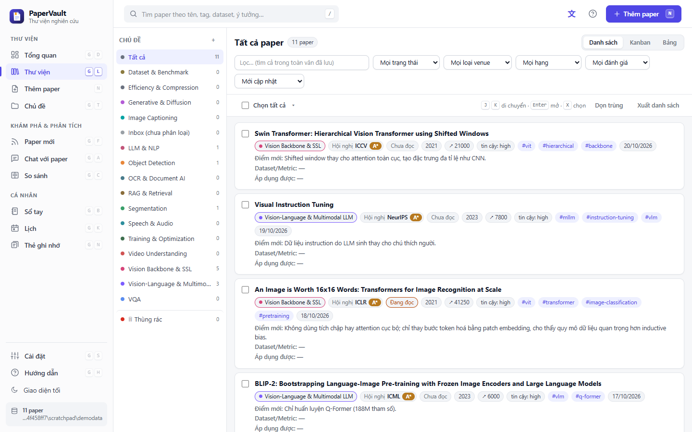
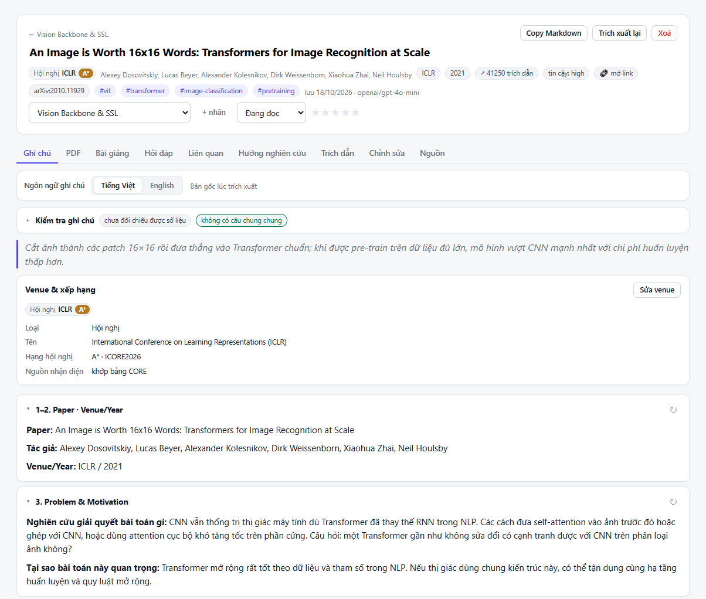
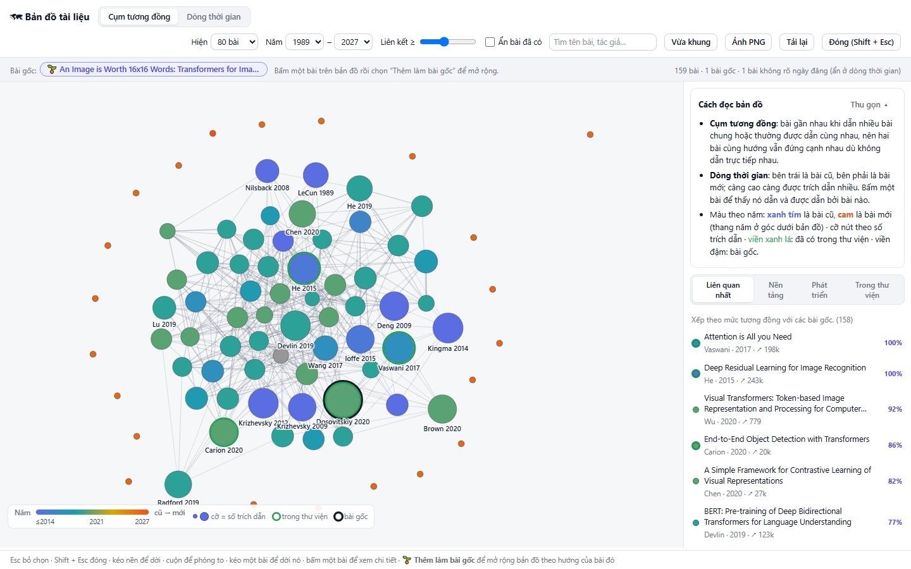
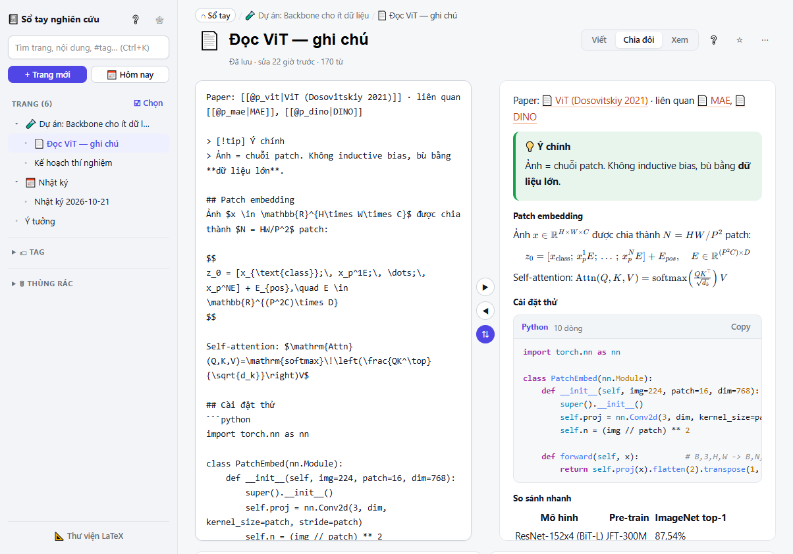
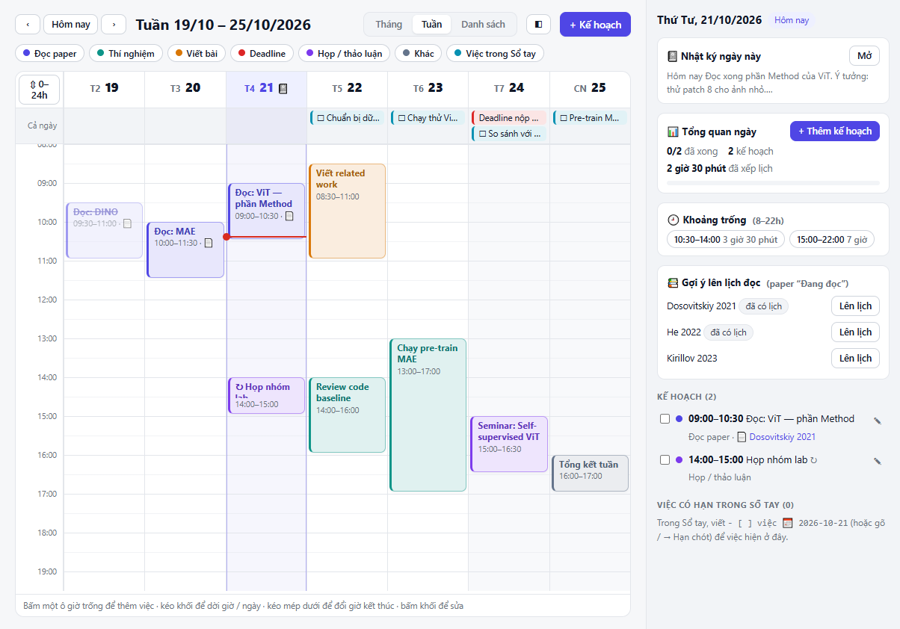
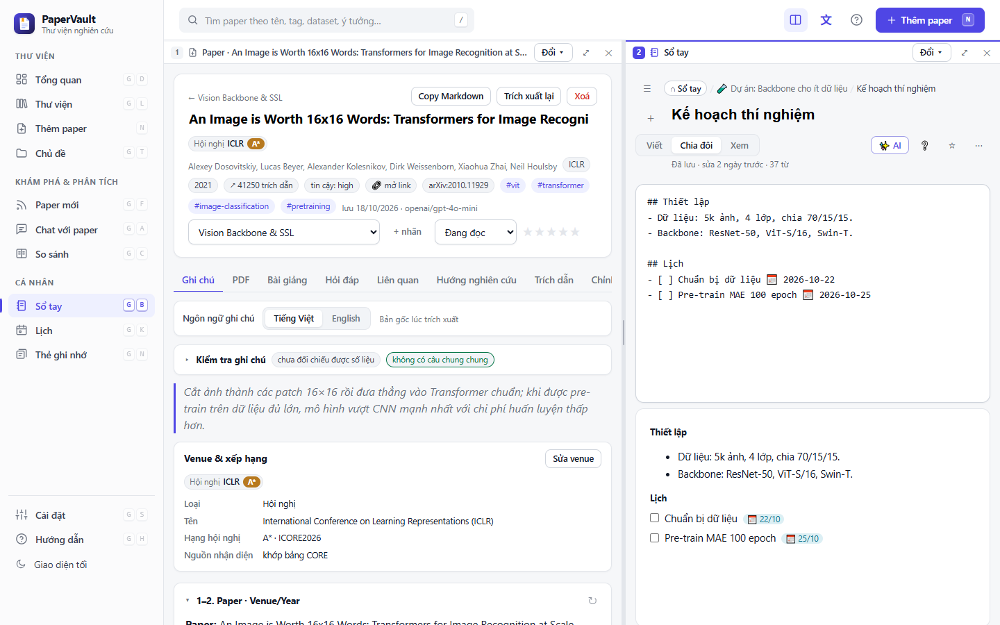
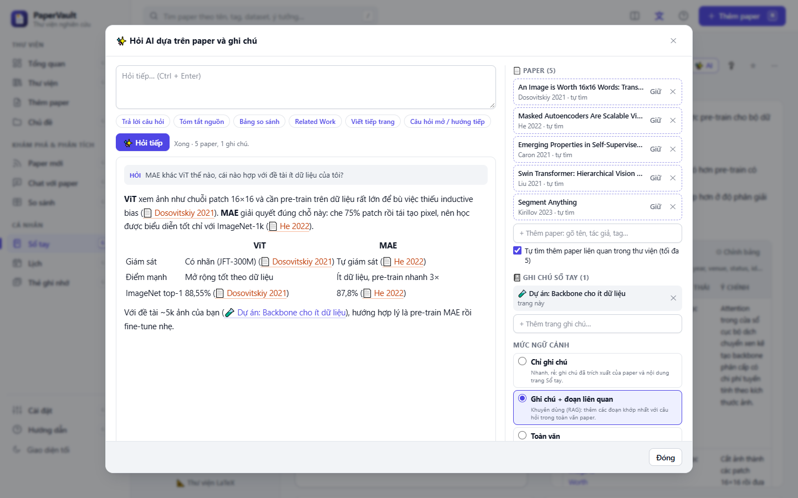
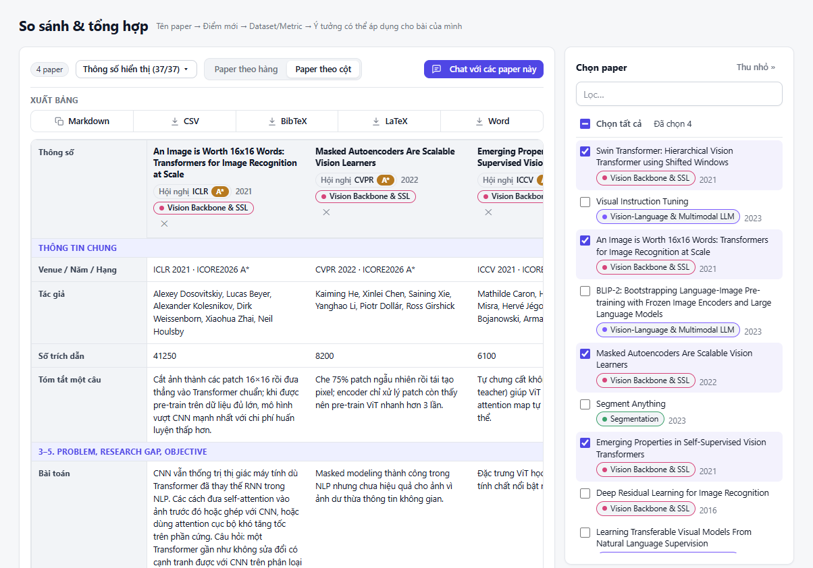

# PaperVault

**Thư viện nghiên cứu cá nhân cho người đọc paper.** Thêm paper bằng link arXiv, DOI hoặc file PDF. AI đọc và viết ghi chú có cấu trúc. Bạn so sánh các bài, xem bản đồ trích dẫn, ghi chép trong sổ tay và lên lịch đọc, tất cả trong một app chạy trên máy bạn.

[**⬇ Tải bản Windows**](../../releases/latest) · [Bắt đầu trong 3 bước](#bắt-đầu-trong-3-bước) · [Tính năng](#tính-năng) · [Extension Chrome](#extension-chrome--edge) · [Câu hỏi thường gặp](#câu-hỏi-thường-gặp)

---

## Có gì trong PaperVault

| | |
| --- | --- |
| **Ghi chú paper tự động.** AI đọc toàn văn rồi điền ghi chú theo template: bài toán, research gap, phương pháp, dataset, kết quả, hạn chế. App kiểm tra từng con số trong ghi chú có thật trong bài không. |  |
| **Bản đồ tài liệu.** Từ một bài, app vẽ các bài liên quan theo cụm tương đồng hoặc theo dòng thời gian trích dẫn. Màu theo năm, cỡ theo số trích dẫn, viền xanh là bài đã có trong thư viện. |  |
| **Sổ tay nghiên cứu.** Viết Markdown với công thức LaTeX, khối code tô màu, bảng paper lấy thẳng từ thư viện, liên kết `[[trang]]` và `[[@paper]]`. Chế độ chia đôi viết / xem giống Overleaf. |  |
| **Lịch kế hoạch.** Xem theo tháng, tuần hoặc danh sách. Bấm một ô 30 phút để thêm việc, kéo để dời giờ. Lịch nối với nhật ký và việc có hạn trong Sổ tay, gợi ý khung giờ trống để đọc paper. |  |
| **Chia đôi màn hình.** Hai chức năng cạnh nhau: đọc paper bên trái, viết Sổ tay bên phải, hoặc Thư viện ở trên, Chat ở dưới. Có sẵn bố cục nhanh, kéo thanh giữa hay nhập % để chỉnh tỉ lệ. Lưu ở khung này thì khung kia tự cập nhật. |  |
| **AI ngay trong Sổ tay.** Bôi đen một đoạn rồi `Ctrl + J` để cải thiện, rút gọn, giải thích, dịch, chuyển thành bảng, giống Notion AI. Hoặc hỏi với nguồn: chọn paper và trang ghi chú (hoặc để app tự tìm paper liên quan), AI tìm đoạn khớp nhất trong toàn văn rồi trả lời có ghi nguồn, chèn vào trang thành liên kết bấm được. |  |
| **So sánh nhiều paper.** Bảng so sánh theo hàng hoặc theo cột, chọn thông số cần xem, xuất Markdown, CSV, BibTeX, LaTeX hoặc Word. |  |

---

## Bắt đầu trong 3 bước

1. **Tải app.** Vào [Releases](../../releases/latest), tải `PaperVault-windows.zip`, giải nén ra thư mục bất kỳ rồi chạy `PaperVault.exe`.
   - Windows có thể hiện cảnh báo SmartScreen vì app chưa ký số. Bấm **More info → Run anyway**.
   - App cần WebView2 Runtime. Windows 11 có sẵn. Nếu Windows 10 không mở được app, cài *Microsoft Edge WebView2 Runtime* từ trang của Microsoft.
2. **Nhập API key.** Mở **Cài đặt**, chọn Claude, OpenAI hoặc Gemini rồi dán key, bấm **Kiểm tra kết nối**. Ghi thêm một câu mô tả đề tài của bạn: AI dùng nó để viết mục "liên quan tới bài của tôi". Muốn dùng model khác cho từng việc (ví dụ model rẻ cho Chat, model mạnh cho trích xuất), mở **Model riêng cho từng việc** ngay dưới đó.
3. **Thêm paper đầu tiên.** Bấm **+ Thêm paper** (phím `N`), dán link arXiv, DOI hoặc thả file PDF. App tự tải toàn văn, PDF và viết ghi chú.

> Không dùng Windows? Cài Python 3.10 trở lên, tải repo về rồi chạy `python app/server.py` và mở `http://127.0.0.1:8765` trong trình duyệt. Không cần cài thêm thư viện nào. Muốn chạy trong cửa sổ riêng: `pip install -r app/requirements.txt` rồi `python app/desktop.py`.

---

## Tính năng

Thanh bên trái của app chia thành ba nhóm. Mỗi trang có nút **?** mở đúng mục hướng dẫn. Nút ◫ trên thanh trên cùng (hoặc `Ctrl + \`) chia màn hình thành hai khung dọc hoặc ngang, mỗi khung mở một chức năng.

### Thư viện

- **Thêm paper** từ arXiv ID, link, DOI, PDF hoặc văn bản dán vào. Thêm hàng loạt bằng cách dán cả danh sách link hoặc thả cả thư mục PDF. Nhập file `.bib` / `.ris` từ Zotero, Mendeley.
- **Thư viện** xem dạng danh sách, kanban hoặc bảng. Lọc theo chủ đề, trạng thái đọc, năm, hạng venue. Tìm được cả trong toàn văn.
- **Venue và xếp hạng** tự nhận diện: hạng hội nghị theo CORE/ICORE (A\*, A, B, C), tạp chí theo Scimago (Q1–Q4).
- **Trang paper** có các tab: Ghi chú, PDF, Bài giảng, Hỏi đáp, Liên quan, Hướng nghiên cứu, Trích dẫn, Chỉnh sửa, Nguồn.
  - *PDF*: bôi đen để dịch theo ngữ cảnh, tô sáng, gạch chân, AI tô các câu đáng nhớ.
  - *Bài giảng*: AI viết lại bài thành bài giảng tám phần, có ví dụ chạy tay và câu tự kiểm tra.
  - *Hướng nghiên cứu*: so sánh bài với các bài nó dẫn và các bài dẫn nó, chỉ ra vấn đề còn bỏ ngỏ và gợi ý hướng làm tiếp.

### Khám phá và phân tích

- **Paper mới**: theo dõi arXiv theo từ khoá, tác giả hoặc bài dẫn một bài bạn quan tâm.
- **Chat với paper**: hỏi đáp trên nhiều paper cùng lúc. Câu trả lời ghi rõ nguồn [P1], [P2], bấm để mở paper.
- **So sánh**: bảng so sánh nhiều paper, xuất ra nhiều định dạng.
- **Bản đồ tài liệu 2D** và **đồ thị trích dẫn 3D** dựa trên dữ liệu Semantic Scholar.

### Cá nhân

- **Sổ tay**: trang Markdown lồng nhau, mẫu trang có sẵn (ghi chú đọc paper, họp nhóm, kế hoạch thí nghiệm…), thư viện macro LaTeX nhập từ file `.tex` / `.sty`, chèn ảnh bằng dán hoặc kéo thả, đồ thị liên kết giữa các trang. Nút **✨ AI** (hoặc `/ai`, `Ctrl + J`) hỏi AI dựa trên paper và ghi chú bạn chọn.
- **Lịch**: kế hoạch theo ngày giờ, lặp lại hằng ngày, tuần hoặc tháng, nối với nhật ký và việc có hạn (`- [ ] việc 📅 2026-10-30`) trong Sổ tay.
- **Thẻ ghi nhớ**: gom các đoạn bạn lưu khi đọc PDF (bôi đen → *+ Ghi chú*) và các trích dẫn thêm tay, ôn lại bằng cách lật thẻ.

Danh sách chi tiết từng chức năng nằm ở [app/README.md](app/README.md).

---

## Extension Chrome / Edge

Extension giúp lưu paper ngay khi đang đọc trên trình duyệt:

1. Mở `chrome://extensions` (hoặc `edge://extensions`), bật **Developer mode**.
2. Bấm **Load unpacked** rồi chọn thư mục repo này (thư mục có `manifest.json`).
3. Mở một trang paper, bấm icon PaperVault → **→ App** để đẩy paper sang app đang chạy.

Extension cũng tự trích xuất và lưu thư viện riêng được, không cần app. Hướng dẫn đầy đủ: [docs/extension.md](docs/extension.md).

---

## Câu hỏi thường gặp

**Dữ liệu của tôi nằm ở đâu?**
Trên máy bạn. Bản Windows lưu trong thư mục `data` cạnh `PaperVault.exe`. Khi chạy từ mã nguồn, dữ liệu nằm trong `app/data`. App không gửi thư viện của bạn lên máy chủ nào. Chỉ phần nội dung cần cho AI được gửi tới nhà cung cấp bạn chọn, kèm key của bạn.

**Tốn bao nhiêu tiền API?**
Một paper đọc toàn văn tốn khoảng 15–20 nghìn token đầu vào. Trang Tổng quan hiển thị số token đã dùng trong tháng. Muốn tiết kiệm, chọn mức effort thấp hoặc model nhỏ (Haiku, Flash, gpt-4o-mini) trong Cài đặt.

**Đồng bộ giữa nhiều máy được không?**
Được. Trong Cài đặt, chuyển thư mục dữ liệu vào OneDrive hoặc Google Drive. Chỉ mở app trên một máy tại một thời điểm. Xem [hướng dẫn dùng cloud](app/README.md#4-dùng-dữ-liệu-trên-cloud-onedrive--google-drive).

**Sao lưu thế nào?**
Cài đặt → **Sao lưu & nhập dữ liệu** → *Tải file sao lưu JSON*. File chứa paper, ghi chú, sổ tay và lịch. File PDF và ảnh trong sổ tay không nằm trong bản sao lưu, hãy chép thêm thư mục `data/pdfs` và `data/images`.

---

## Cho người phát triển

- `app/`: máy chủ Python (chỉ dùng thư viện chuẩn, SQLite) và giao diện JavaScript thuần trong `app/static`. Bản desktop dùng pywebview, đóng gói bằng PyInstaller qua `app/build_exe.bat`.
- `src/`, `manifest.json`: extension Chrome / Edge (Manifest V3).
- Mỗi tag `v*` đẩy lên GitHub sẽ chạy [workflow](.github/workflows/release.yml) build `PaperVault-windows.zip` và đăng lên Releases.

## Giấy phép

[MIT](LICENSE). Ảnh chụp màn hình trong README dùng dữ liệu mẫu.
